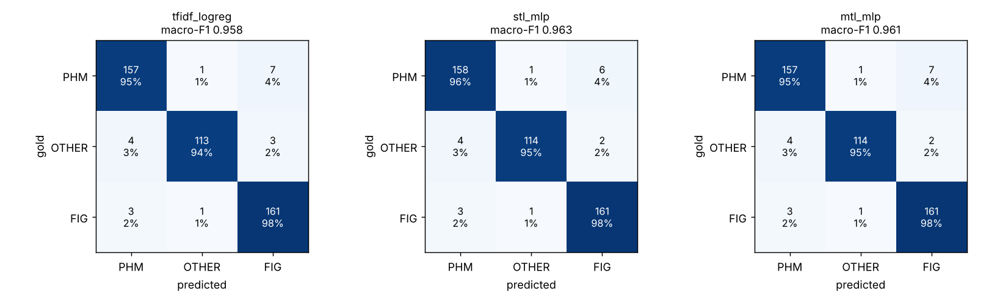
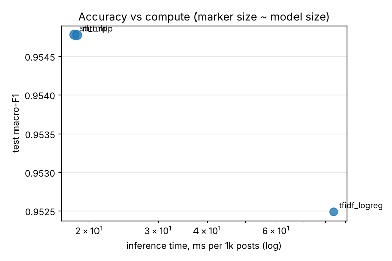

# Personal Health Mention classification — results

Data: **synthetic (n=2994)** · seeds: [0, 1, 2] · split 70/15/15 stratified.

> ⚠️ Synthetic, template-generated data: numbers demonstrate the pipeline, not real-world performance. Run with `--data` on a real annotated corpus.

## Model comparison (test set, mean over seeds)

| model | macro-F1 (±sd) | acc | AUC | aux fig-F1 | train s | ms / 1k posts | params | size MB |
|---|---|---|---|---|---|---|---|---|
| tfidf_logreg | 0.952 ± 0.007 | 0.953 | 0.973 | – | 1.0 | 84.1 | 17,244 | 0.34 |
| stl_mlp | 0.955 ± 0.008 | 0.955 | 0.975 | – | 0.6 | 18.4 | 254,724 | 1.10 |
| mtl_mlp | 0.955 ± 0.006 | 0.955 | 0.975 | 0.929 | 0.6 | 18.7 | 254,724 | 1.10 |

### Per-class F1

| model | LITERAL_PHM | LITERAL_OTHER | FIGURATIVE |
|---|---|---|---|
| tfidf_logreg | 0.953 | 0.952 | 0.952 |
| stl_mlp | 0.955 | 0.955 | 0.955 |
| mtl_mlp | 0.955 | 0.955 | 0.955 |

## Significance (seed-0 test split)

| comparison | McNemar p | A✓B✗ / A✗B✓ | Δ macro-F1 [95% CI] |
|---|---|---|---|
| mtl_mlp vs stl_mlp | 1 | 0 / 1 | -0.002 [-0.006, +0.000] |
| mtl_mlp vs tfidf_logreg | 1 | 1 / 0 | +0.002 [+0.000, +0.008] |

## Error analysis

Accuracy by slice (seed-0 test split):

| slice              |   n |   acc_tfidf_logreg |   acc_stl_mlp |   acc_mtl_mlp |
|:-------------------|----:|-------------------:|--------------:|--------------:|
| medium             | 277 |              0.953 |         0.957 |         0.953 |
| slang_or_emoji     | 231 |              0.974 |         0.978 |         0.974 |
| short(<=6w)        |  90 |              0.956 |         0.967 |         0.967 |
| long(>12w)         |  83 |              0.976 |         0.976 |         0.976 |
| mention_or_url     |  81 |              0.938 |         0.951 |         0.938 |
| question           |  31 |              1     |         1     |         1     |
| simile_or_metaphor |  27 |              1     |         1     |         1     |
| third_person       |  15 |              1     |         1     |         1     |
| near_miss_phrase   |   6 |              1     |         1     |         1     |

Most frequent confusions:

- **tfidf_logreg**: LITERAL_PHM -> FIGURATIVE (7); LITERAL_OTHER -> LITERAL_PHM (4); FIGURATIVE -> LITERAL_PHM (3); LITERAL_OTHER -> FIGURATIVE (3); LITERAL_PHM -> LITERAL_OTHER (1)
- **stl_mlp**: LITERAL_PHM -> FIGURATIVE (6); LITERAL_OTHER -> LITERAL_PHM (4); FIGURATIVE -> LITERAL_PHM (3); LITERAL_OTHER -> FIGURATIVE (2); LITERAL_PHM -> LITERAL_OTHER (1)
- **mtl_mlp**: LITERAL_PHM -> FIGURATIVE (7); LITERAL_OTHER -> LITERAL_PHM (4); FIGURATIVE -> LITERAL_PHM (3); LITERAL_OTHER -> FIGURATIVE (2); LITERAL_PHM -> LITERAL_OTHER (1)

**Likely annotation errors:** 9 test posts where every model confidently (p ≥ 0.85) agrees on a label other than gold — 47% of all errors. These are re-annotation candidates rather than model failures.
On synthetic data the injected label flips are known: detector precision 1.00, recall 0.75.

Models disagreed on 1 test posts; full predictions in `test_predictions.csv`.

## Explainability

Per-post attributions are in **`explanations.html`** (LR exact contributions, occlusion, LIME-style surrogate; Integrated Gradients for DistilBERT). Global LR features: `lr_top_features.png`.

Faithfulness (deleting the top-2 attributed words vs 2 random words; larger gap = more faithful):

| model / method | n | Δp top-2 | Δp random-2 |
|---|---|---|---|
| tfidf_logreg / occlusion | 150 | 0.265 | 0.065 |
| tfidf_logreg / lime | 60 | 0.271 | 0.070 |
| mtl_mlp / occlusion | 150 | 0.220 | 0.070 |
| mtl_mlp / lime | 60 | 0.221 | 0.076 |
| tfidf_logreg / exact-linear | 150 | 0.259 | 0.065 |
